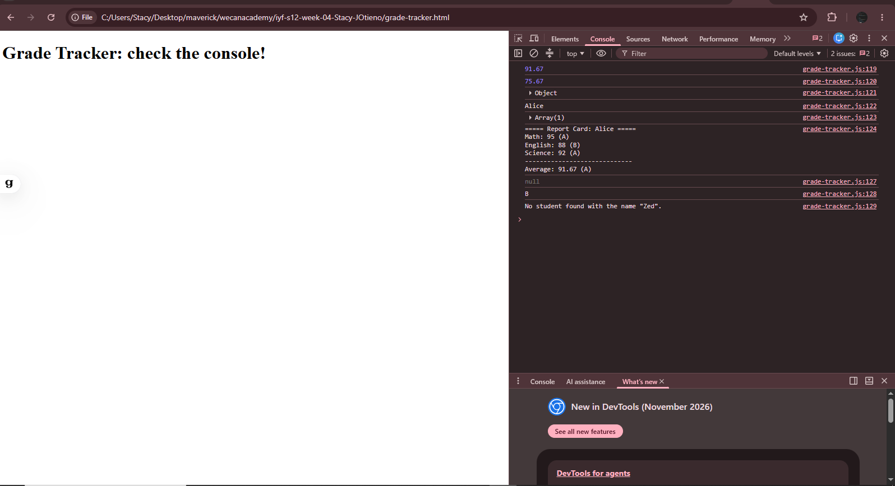

# Week 4: JavaScript Fundamentals

## Author
- **Name:** Stacy Otieno
- **GitHub:** [@Stacy-JOtieno](https://github.com/Stacy-JOtieno)
- **Date:** November 9, 2026

## Project Description
A set of JavaScript practice exercises and mini-projects covering the language basics: variables, data types and operators, functions, control flow, arrays, objects, JSON, and array-of-objects data. It includes two mini-projects, a console calculator and a student grade tracker, plus daily coding challenges (FizzBuzz, reverse a string, largest number, remove duplicates, palindrome checker). All output is viewed in the browser console.

## Technologies Used
- HTML5
- JavaScript (ES6+)
- Git and GitHub
- VS Code with the Live Server extension

## Features
- Variables, `typeof`, and `let` vs `const` (Task 7.1)
- Number, string, comparison and logical operators, plus age calculations (Task 7.2)
- Function declarations, expressions, arrow functions and default parameters (Task 7.3)
- If/else, switch, loops, FizzBuzz and a star triangle (Task 7.4)
- Console calculator supporting `+`, `-`, `*`, `/`, `%`, `**` with division-by-zero handling
- Array methods: `map`, `filter`, `find`, `reduce`, `some`, `every`, `sort` (Tasks 8.1 and 8.3)
- Objects, nested properties, methods and iteration with `Object.entries` (Task 8.2)
- JSON parsing and stringifying, with `try/catch` error handling (Task 8.4)
- Student Grade Tracker: add students, averages, top student, struggling students, letter grades and report cards
- Daily challenges solved with more than one approach (loops, built-ins, `reduce`, `Set`, `filter`)

## How to Run
1. Clone this repository:
   `git clone https://github.com/Stacy-JOtieno/iyf-s12-week-04-Stacy-JOtieno.git`
2. Open the folder in VS Code.
3. Right-click any HTML file and choose **Open with Live Server**.
4. Press **F12** and open the **Console** tab to see the output.

Each exercise has its own page, so open the one you want:
- `index.html` (Task 7.1)
- `calculator.html`
- `arrays.html`
- `objects.html`
- `students.html`
- `json.html`
- `grade-tracker.html`
- `challenges.html`

## Lessons Learned
- `const` stops a variable from being reassigned, but the contents of arrays and objects can still change.
- Use `===` instead of `==` to avoid surprising type conversion.
- `map`, `filter` and `reduce` replace many manual loops, and `sort` changes the original array unless you copy it first with `[...array]`.
- JSON is just text: `JSON.parse` turns it into data, `JSON.stringify` turns data back into text, and invalid JSON throws a `SyntaxError`.
- Inside object methods, `this` refers to the object, so shorthand methods work better than arrow functions there.

## Challenges Faced
- **Name clashes between files:** Loading several scripts on one page caused errors like `Identifier 'add' has already been declared`. I fixed it by giving each exercise its own HTML page and script file.
- **Division and modulus by zero:** JavaScript returns `Infinity` or `NaN` instead of an error, so I added explicit checks that return a clear message.
- **Rounding averages:** `toFixed()` returns a string, so I wrapped it in `Number()` to keep the result a number.

## Screenshots (optional)

## Live Demo (if deployed)
Not deployed. This project runs locally through the browser console.